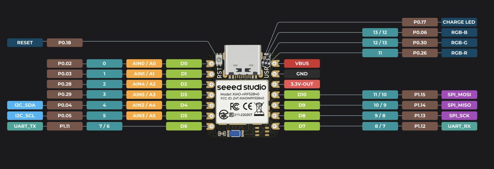

# buslab — wireless I²C & serial workbench

https://github.com/user-attachments/assets/53db78b7-d3a2-450a-b99e-5d2d96376190

**[Open the web client at buslab.let.run](https://buslab.let.run)** — try **Explore a sample** without hardware, or connect your board to work with your own devices.

buslab turns a **Seeed Studio XIAO nRF52840** into a wireless interface for I²C devices and UART serial ports. Connect the board to your hardware, then use the web client over Bluetooth Low Energy to read registers, send commands, inspect bytes, or work with a serial terminal.

The project includes the board firmware and a browser client. The client talks directly to your board; no backend or account is required. This is a BLE bridge with a UART terminal, rather than a Bluetooth Classic serial/COM port.

## What you can do

- **Work with I²C:** discover responding addresses, read and write data, and inspect response bytes bit by bit.
- **Use serial wirelessly:** send text or hex and view incoming UART data in its own tab, alongside the I²C tools.
- **Automate sequences:** edit and run JavaScript scripts with delays, status checks, logs, and progress.
- **Pre-cache binary blobs:** transfer a binary to the board over BLE first, then send it locally as one continuous I²C write when your device is ready. The staging buffer holds up to **32 KiB** and lasts until consumed, replaced, or disconnected; it is not persistent storage.

## Example: uploading firmware to a TPS25751 over I²C

The included **TPS25751 Patch Burst Mode** script demonstrates uploading a firmware/configuration patch to TI's USB-C Power Delivery controller:

1. Select a valid TPS25751 **Low Region Binary** generated for your target.
2. Pre-cache the binary on the nRF52840 before starting the controller's timed patch-loading sequence.
3. Prepare Patch Burst Mode, then stream the staged binary over I²C without Bluetooth delays between chunks.
4. Complete the patch command and check status and application mode.

Choose the example in **I²C script & binary file**, set its target and patch addresses for your hardware, and run it after connecting. Selecting a file alone sends nothing. The example has protocol-model tests; physical TPS25751 patch loading still needs hardware validation. See [SPECS.md](SPECS.md#tps25751-patch-burst-mode-example) for the complete sequence and limits.

## Board and wiring

The firmware is configured for the **Seeed Studio XIAO nRF52840**, based on Nordic's nRF52840 chip. Its I²C bus runs at **100 kHz**; UART uses **115200 baud, 8-N-1**, without flow control.

| Function | XIAO pin | nRF52840 pin | Connection / behavior |
| --- | --- | --- | --- |
| I²C SDA | D4 | P0.04 | Target SDA |
| I²C SCL | D5 | P0.05 | Target SCL |
| UART TX | D6 | P1.11 | Target RX |
| UART RX | D7 | P1.12 | Target TX |
| Connection LED | Onboard green | P0.30 | On while BLE is connected; active-low |
| Activity LED | Onboard blue | P0.06 | Pulses for BLE data traffic; active-low |

**These pins are predefined in [src/main.rs](src/main.rs).** If you use another board or different wiring, modify the I²C and UART pin assignments and both LED assignments before building. Adapt the LED polarity and board memory layout as needed; the supplied flash layout assumes SWD programming at address zero and does not preserve a bootloader.



*Pinout reference supplied with this project; the table above lists the pins used by the firmware.*

Connect board and target grounds together. Use compatible **3.3 V logic**, cross UART TX/RX, and use external I²C pull-ups to the compatible logic supply. Do not connect GPIO to USB VBUS or RS-232 voltage levels.

## Get started

1. Build and flash the firmware using the [build and flashing instructions](SPECS.md#build).
2. Wire your I²C or UART target using the table above.
3. Open **[buslab.let.run](https://buslab.let.run)** in desktop Chrome or Edge on a system with Web Bluetooth support.
4. Click **Connect device**, select **BLE-I2C-UART-v2**, and choose the I²C or UART tab. Disconnect other BLE clients first; the board supports one connection at a time.

You can also run the client locally, with no installation or build step:

```sh
python3 -m http.server 8000 --bind 127.0.0.1 --directory ble-i2c-console
```

Open [localhost:8000](http://localhost:8000). **Explore a sample** previews the response and bit inspector without hardware. Remote hosting requires HTTPS for Web Bluetooth.

## Further reading

- [SPECS.md](SPECS.md) — technical project definition, build details, BLE protocol, staging, and firmware behavior.
- [Web client guide](ble-i2c-console/README.md) — controls, scripts, troubleshooting, and tests.
- [MIT License](LICENSE).
